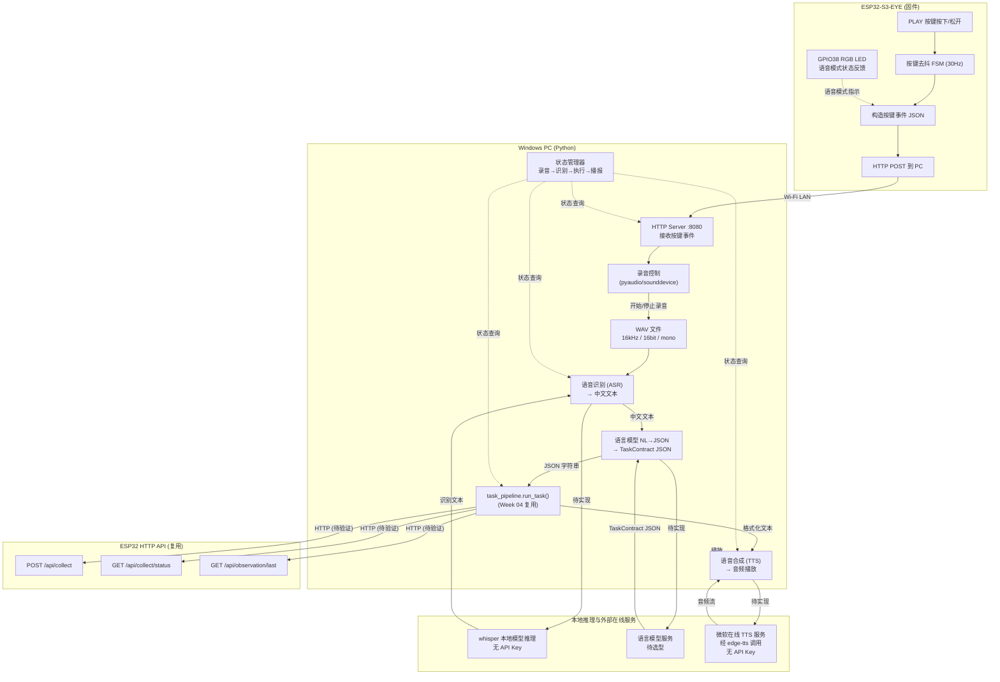
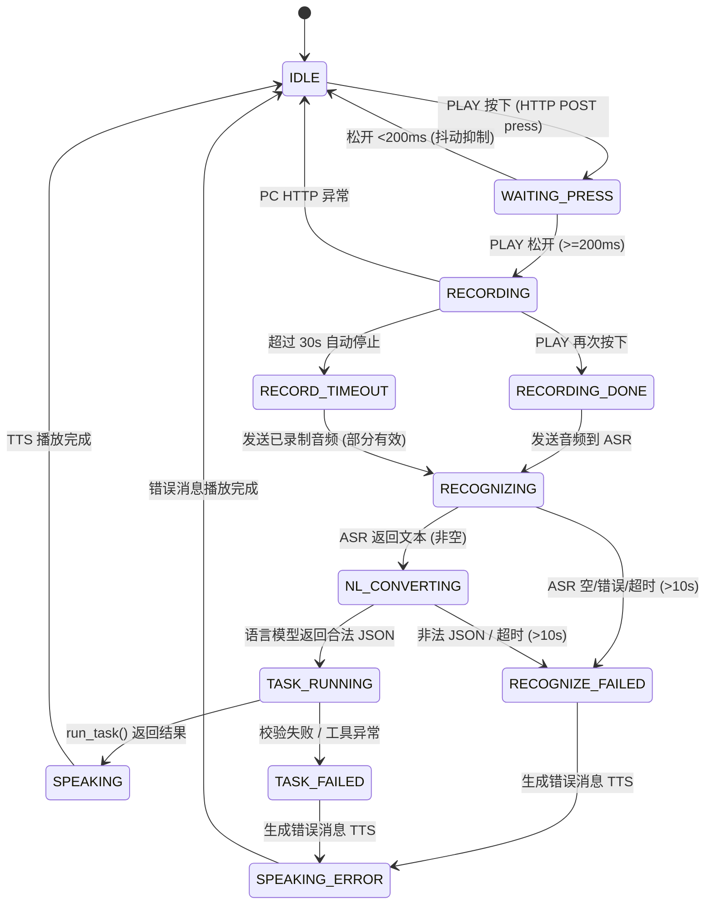

# Week 05 语音交互架构设计

> **状态**: 方案已形成，功能未实现  
> **分支**: `feature/week05-voice-interaction` (HEAD `ae5c467`)  
> **基线**: `7dd788b` (origin/main, PR #4)  
> **设计日期**: 2026-10-10  
> **来源**: 课程官网 `https://ai.openkub.com/courses/ai-interaction-ux/#week-05` + 本地课程 HTML + 实际源码审计

---

## 1. 课程要求摘要

来源：课程官网 Week 5 任务卡，`每周计划/AI交互原型与用户体验设计 · AI教研室.html` L960–L967

| 项目 | 内容 |
|------|------|
| 学时 | 理论 2 + 实践 2 |
| 本周问题 | 从"说一句话"到"听到回答"，需要经过哪些可观察的环节？ |
| 前 2 学时 | 音频输入、采样格式、语音识别和文本中间结果；按键开始/结束录音，音频→任务文本 |
| 后 2 学时 | 复用 Week 04 任务处理，连接语音合成；显示录音/识别/任务执行/播放状态，文字与语音入口对照 |
| 当堂验证 | 无声、识别失败、服务超时都产生可理解反馈；文字入口保持可用 |
| 提交 | 真实语音输入→文本任务→语音输出链路；音频来源与运行位置记录 |
| 范围控制 | 基础语音为按键式半双工，保留文字通道；语言和语音采用授权预训练服务 |
| 备用路径 | 录音设备故障时用授权录音完成真实识别；设备音频未就绪时使用电脑音频，但明确运行位置 |

---

## 2. 完整数据流（Mermaid 流程图）



**图例**: 实线=数据/控制流, 虚线=状态查询, `待实现`=模块未编写, `待验证`=代码存在但未经真实服务测试

---

## 3. 模块与运行位置

| 模块 | 运行位置 | 职责 | 状态 |
|------|----------|------|------|
| **按键扫描&去抖** | ESP32 固件 | 30Hz FreeRTOS 任务检测 PLAY 按键，去抖后通过 Queue 通知 | ✅ 已有 (`help_event.c` 按键扫描任务, `adc_button.c` 驱动) |
| **按键事件→PC** | ESP32 固件 | 将按键事件 JSON 通过 HTTP POST 发送到 PC | ⏳ 待实现 (需新增 ESP32 HTTP client 调用) |
| **语音模式 LED** | ESP32 固件 | GPIO38 RGB LED 指示语音交互阶段 | ⏳ 待实现 (可复用 `help_led_update()` 框架) |
| **PC HTTP Server** | Windows Python | 接收 ESP32 按键事件，管理语音交互状态机 | ⏳ 待实现 |
| **音频录音** | Windows Python | sounddevice 采集麦克风 16kHz/16bit/mono PCM，存为 WAV | ⏳ 待实现 (**待验证**: 麦克风可用性) |
| **ASR 语音识别** | Windows PC (本地 Python) | **whisper 本地模型推理**：WAV 音频→中文文本；**不需要 ASR API Key**。前置条件：依赖安装、首次下载模型权重、FFmpeg、电脑推理性能 | ⏳ 待实现 (**待确认**: 前置条件就绪；推理性能) |
| **NL→结构化任务** | 外部服务/本地 Python | 将中文自然语言转换为 TaskContract JSON | ⏳ 待实现 (**待确认**: 语言模型选型与凭据) |
| **任务处理管道** | Windows Python | `run_task()` — 校验 JSON→分发意图→调设备工具→格式化结果 | ✅ 已有 (`service/task_pipeline.py`) |
| **设备 API 调用** | Windows→ESP32 HTTP | query_last/trigger_collect 通过 HTTP 与 ESP32 交互 | 🔧 工具已有，真实 ESP32 HTTP 调用待验证 |
| **TTS 语音合成** | Windows PC 调用微软在线 TTS 服务 | edge-tts 将格式化文本发送给微软在线 TTS 服务→音频播放；**不需要 API Key**，**需要网络连接** | ⏳ 待实现 (**待确认**: 网络连通性；隐私与课程许可) |
| **状态管理器** | Windows Python | 跟踪语音交互全生命周期状态，为 UI 和 LED 提供状态 | ⏳ 待实现 |
| **Web 仪表盘状态显示** | ESP32 HTTP Server | 在现有 Web 页面中增加语音交互状态显示区域 | ⏳ 待实现 (可选) |
| **文字入口 (保留)** | 任意 HTTP Client | 直接发送 TaskContract JSON 到 `run_task()` | ✅ 已有 (Week 04) |

---

## 4. 按键事件 → PC 方案比较与推荐

### 4.1 通信约束分析

| 约束项 | 事实 | 来源 |
|--------|------|------|
| ESP32 Wi-Fi | 已通过 `wifi_app.c` 连接 LAN，HTTP client 能力已验证 (`help_uplink.c` 使用 `esp_http_client`) | `help_uplink.h` 异步接口已在 `main.c` 集成 |
| ESP32 串口 | 用于 `idf.py monitor` 日志输出 (COM10)，115200bps | 项目规则 / 实机测试记录 |
| PC 网络 | 与 ESP32 在同一 LAN（通过 Wi-Fi AP），可双向 HTTP 通信 | 现有 ESP32 Web 仪表盘通过浏览器访问已验证 |
| ESP32 可用按键 | MENU/PLAY/DOWN/UP+，共 4 个 | `adc_button.h` 枚举定义 |
| Week 03 按键占用 | MENU 按键已绑定 help_event 状态机；所有按键在 `HELP_IDLE` 时都可触发 help_event | `main.c:581` |
| USB 端口 | 单端口，同时用于烧录和串口监视 | 项目规则 |

### 4.2 方案比较

| 方案 | 原理 | 优势 | 劣势 | 可行性 |
|------|------|------|------|--------|
| **A: HTTP 回调** | ESP32 检测按键后 HTTP POST 到 PC 的 HTTP Server | 不需额外硬件；使用已有 Wi-Fi；不占串口 | PC IP 需硬编码或通过 menuconfig 配置 | ✅ **推荐** |
| **B: 串口 UART** | ESP32 printf 特殊标记，PC 端 Python 读串口解析 | 简单直接，无网络依赖 | 占用串口与 monitor 冲突；日志混杂 | ⚠️ 仅调试用 |
| **C: WebSocket** | ESP32 作为 WebSocket client 连接 PC | 双向实时通信 | ESP-IDF WebSocket 实现复杂；过度设计 | ❌ 不推荐首版 |

### 4.3 推荐方案: A — HTTP 回调

**实现纲要**:

```
ESP32 侧:
  PLAY 按下 → JSON {"event":"voice_btn","action":"press","timestamp_us":xxx}
  → esp_http_client POST → http://{PC_IP}:8080/api/voice/button
  → PLAY 松开 → POST {"event":"voice_btn","action":"release",...}

PC 侧:
  Flask/内置 http.server 监听 :8080
  POST /api/voice/button → 解析 event → 更新状态机 → 触发录音开始/停止
```

**关键设计决策**:

1. **按键选择**: 使用 **PLAY** 按键作为语音录制触发键。理由：
   - PLAY (1.98V) 在现有 4 键中语义上最接近"开始/停止"
   - MENU 保留给 help_event（Week 03 已有固化测试记录）
   - 语音模式下 PLAY 按下不触发 help_event 状态机

2. **PC IP 配置**: 通过 ESP-IDF menuconfig 新增 `CONFIG_VOICE_PC_IP` 和 `CONFIG_VOICE_PC_PORT`（默认 8080）。存储在 `sdkconfig`（gitignore）。

3. **故障处理**: HTTP POST 失败时 ESP32 LED 闪烁警告，语音功能不可用但不影响其他功能。文字入口始终可用。

**待验证前提**:
- [ ] PC 防火墙是否允许 ESP32 访问 8080 端口
- [ ] PC 与 ESP32 在同一子网（通过同一 Wi-Fi AP）
- [ ] PC IP 地址稳定（建议静态 IP 或 DHCP 预留）


---

## 5. 核心接口与转换边界

### 5.1 按键事件接口 (ESP32 → PC)

```
POST http://{PC_IP}:8080/api/voice/button
Content-Type: application/json

{
  "event": "voice_btn",
  "action": "press",
  "button": "PLAY",
  "timestamp_us": 123456789,
  "device_id": "esp32s3-eye-wk01"
}
```

**响应** (PC → ESP32):
```json
{"accepted": true, "voice_state": "recording", "message": "录音已开始"}
```

### 5.2 ASR 文本输出格式

```json
{
  "text": "查看最近的加速度数据",
  "confidence": 0.92,
  "language": "zh-CN",
  "duration_ms": 3200
}
```

### 5.3 NL→TaskContract JSON 转换边界 (关键转换边界)

ASR 产生的任意中文句子不能直接传给 `run_task()`。`run_task()` 要求结构化 JSON (参见 `task_schema.py` 的 `TASK_SCHEMA`):

| ASR 输出 | 转换后 TaskContract JSON | 说明 |
|----------|-------------------------|------|
| `"查看最近的加速度数据"` | `{"intent":"query_last","confidence":0.95,"original":"查看最近的加速度数据"}` | 查询意图 |
| `"重新采集一次"` | `{"intent":"trigger_collect","confidence":0.90,"original":"重新采集一次"}` | 采集意图 |
| `"你好"` | `{"intent":"unsupported","confidence":0.85,"original":"你好","reason":"当前仅支持查询加速度数据和触发采集"}` | 不支持 |
| `"那个什么数据"` | `{"intent":"clarify","confidence":0.60,"original":"那个什么数据","question":"请说明你想查询还是采集数据？"}` | 需澄清 |
| (空/无效音频) | `{"intent":"unsupported","confidence":0.0,"original":"","reason":"未检测到有效语音输入"}` | 无声 |

**语言模型 Prompt 设计原则**:
- System prompt 描述四种意图及参数含义
- 约束输出为合法 JSON，匹配 `TASK_SCHEMA`
- `original` 保留 ASR 原始文本
- `confidence` 反映意图分类置信度
- 无法映射到合法意图返回 `unsupported`，不强行分类

### 5.4 run_task() 调用接口 (复用，不修改)

```python
from service.task_pipeline import run_task
result_text: str = run_task(raw_input=task_contract_json)
```

**约束**: `run_task()` 不接受任意中文文本，仅接受结构化 JSON。ASR 文本到 JSON 的转换**必须**由语言模型完成，不可绕过。

### 5.5 状态 ↔ LED 映射 (ESP32)

| 语音交互状态 | LED 模式 | GPIO38 行为 |
|-------------|----------|-------------|
| `IDLE` | 关闭 | 关 |
| `RECORDING` | 快速闪烁 | 200ms 周期 |
| `RECOGNIZING` | 脉冲 | 500ms 周期 |
| `TASK_RUNNING` | 脉冲 | 500ms 周期 |
| `SPEAKING` | 慢闪 | 1s 周期 |
| `FAILED` | 长亮 2s 后关闭 | 长亮 |
| `VOICE_DISABLED` | 关闭 | 关 (help_event 激活时) |

**LED 优先级**: help_event 状态非 IDLE 时，语音 LED 模式不生效。

### 5.6 TTS 输入/输出接口

```
输入: run_task() 返回值 或 错误消息 ("识别失败，请重试"等)
输出: MP3/WAV 音频流 → PC 扬声器/耳机播放
```

---

## 6. 语音交互状态机



### 6.1 状态超时与放弃

| 触发条件 | 动作 |
|----------|------|
| 录音中 PC HTTP Server 不可达 | 15s 超时后 ESP32 自动重置，LED 恢复 IDLE |
| ASR 服务 10s 无响应 | TTS: "语音识别服务超时，请重试" |
| 语言模型 10s 无响应 | TTS: "语言理解服务超时，请使用文字输入" |
| 任务执行超时 (COLLECT_TIMEOUT_MS=5s) | 复用 Week 02 超时逻辑 |
| 任何阶段连续失败 2 次 | 建议使用文字入口 |

### 6.2 与 help_event 状态机隔离

- help_event.status != HELP_IDLE → PLAY 按键不触发语音模式
- voice_state != IDLE → MENU/PLAY 按键不触发 help_event
- 两者同时 IDLE → MENU→help_event, PLAY→voice
- 文字入口 (POST /api/collect 等) 不受任何状态机影响


---

## 7. 服务授权与依赖分析

### 7.1 推荐首版方案

| 模块 | 推荐方案 | 授权 | 运行位置 | 选择依据 |
|------|----------|------|----------|----------|
| **麦克风录音** | `sounddevice` (Python) | MIT | Windows PC | 跨平台，支持 WAV 导出，比 `pyaudio` 更易安装 |
| **ASR 语音识别** | **whisper (base/small)** 本地模型推理 | MIT (模型权重另有许可) | Windows PC (本地) | 1) **不需要 ASR API Key**，无云端 ASR 调用、无凭据管理 2) 离线可用（首次需下载模型权重） 3) 中文识别准确率可接受 4) base 模型 ~142MB，CPU 推理 3-10s 5) 课程许可为独立条件（见 §7.5） |
| **语言模型 NL→JSON** | **DeepSeek API** 或 **本地 Qwen2.5-1.5B (Ollama)** | 服务条款授权 | 云端 (DeepSeek) 或 PC 本地 | 1) DeepSeek: 便宜且中文强，REST API 2) Qwen 本地: 无 API 凭据，离线可用。**需教师确认授权** |
| **TTS 语音合成** | **edge-tts** (Python 客户端) → **微软在线 TTS 服务** | 客户端 MIT；服务为 Microsoft 在线服务 | Windows PC 调用**微软在线 TTS 服务**（非本地 TTS） | 1) **不需要 API Key** 2) **需要网络连接**，离线不可用 3) **合成文本会发送给外部服务** 4) 中文普通话语音自然度高 5) 隐私与课程许可待确认（见 §7.5） |

### 7.2 方案限制与风险

| 方案 | 限制 |
|------|------|
| whisper 本地 | 前置条件：安装 Python 依赖 (openai-whisper 等) 与 **FFmpeg**（音频解码）；首次运行需下载模型权重 (~142-466MB，需网络)；CPU 推理速度取决于**电脑性能** (base 约 3-10s)；嘈杂环境准确率下降 |
| DeepSeek API | 需网络 + API Key（不得写入仓库）；免费额度有限 |
| Qwen 本地 (Ollama) | 需安装 Ollama + 下载模型 (~1-3GB)；需足够 RAM |
| edge-tts | PC 端调用**微软在线 TTS 服务**：**需要网络连接**，无网络即不可用；**不需要 API Key**；**合成文本会发送给外部服务**（隐私待确认） |

### 7.3 依赖清单 (Python)

```
# requirements_voice.txt (待创建)
sounddevice>=0.4.6       # 音频采集 (MIT)
numpy>=1.24.0            # 音频数据处理 (BSD)
openai-whisper>=20231117 # 本地 ASR 推理 (MIT) — 首版方案；不需要 API Key，首次运行自动下载模型权重
edge-tts>=6.1.0          # TTS 合成 (MIT) — 调用微软在线服务，需网络，无 API Key
flask>=3.0.0             # PC HTTP Server (BSD)

# 系统前置 (非 pip 包):
#   FFmpeg — whisper 音频解码依赖，需单独安装并加入 PATH
#   模型权重 — whisper 首次运行自动下载 (~142-466MB, 需网络)

# 若使用 DeepSeek API (备选):
# openai>=1.0.0          # DeepSeek 兼容 OpenAI SDK (Apache 2.0)

# 若使用 Ollama 本地 LLM (备选):
# ollama>=0.1.0          # Ollama Python client (MIT)
```

### 7.4 配置与安全

| 配置项 | 位置 | 存储 | 安全要求 |
|--------|------|------|----------|
| PC_IP + Port | ESP32 `sdkconfig` (menuconfig) | 本地 (gitignore) | 不写入仓库 |
| LLM API Key | PC 环境变量 `VOICE_LLM_KEY` | 本地，不写入仓库 | 不写入仓库/提交/截图 |
| ASR (whisper 本地推理) | 不需要 API Key | — | 无云端凭据；课程许可为独立条件（见 §7.5） |
| TTS (edge-tts → 微软在线服务) | 不需要 API Key | — | 合成文本会发送给外部服务，隐私待确认（见 §7.5） |
| 音频文件 | PC 临时目录 `%TEMP%/voice_task/` | 本地 | 录音文件不提交 |

### 7.5 课程许可与隐私（独立于 API Key 的待确认项）

> 本节记录的是**课程许可 / 隐私确认**，与 API Key（凭据管理）属于两类不同事项，不得混为一谈。

| # | 事项 | 性质 | 当前状态 | 确认方式 |
|---|------|------|----------|----------|
| L1 | 教师确认可使用的模型或服务范围（whisper 模型 + 微软在线 TTS 服务） | 课程许可 | ⏳ 待确认 | 向教师/助教确认并记录 |
| L2 | whisper 模型权重的许可与下载来源 | 模型许可 | ⏳ 待确认 | 使用官方发布来源（openai-whisper 自动下载） |
| L3 | edge-tts 合成文本会发送给微软在线服务 | 隐私 | ⏳ 待确认 | 仅发送任务结果/状态提示文本（不含录音音频）；与教师确认允许范围 |
| L4 | 录音 WAV 与临时文件的留存 | 隐私 | ⏳ 待确认 | 仅存本地 `%TEMP%/voice_task/`，不提交仓库；留存时长待定 |

**事实边界**:

- whisper = **本地模型推理**：音频不上传外部语音识别服务，**不需要 ASR API Key**；前置条件为依赖安装、首次下载模型权重、FFmpeg、电脑推理性能。
- edge-tts = Python 客户端，**PC 端调用微软在线 TTS 服务**：**需要网络连接**、**不需要 API Key**、**合成文本会发送给外部服务**。

---

## 8. 异常处理矩阵

| 异常类型 | 检测方式 | 用户反馈 | 恢复路径 |
|----------|----------|----------|----------|
| **无声** (录音电平 < 阈值) | RMS 能量检测 | TTS: "未检测到语音，请重试" + LED: FAILED | 重置为 IDLE，等待下次按键 |
| **录音过短** (<200ms) | 音频时长检测 | 不触发 ASR，静默回到 IDLE | 抖动抑制 |
| **录音过长** (>30s) | 录音计时器 | 自动停止录音，处理已有音频 | 进入 RECOGNIZING |
| **ASR 返回空** | text 为空或 confidence < 0.3 | TTS: "未能识别语音内容，请重试或使用文字输入" | IDLE |
| **ASR 超时** (>10s) | 计时器 | TTS: "语音识别超时，请检查网络后重试" | IDLE |
| **语言模型返回非法 JSON** | JSON 解析失败 | TTS: "语言理解出错，请使用文字输入" | IDLE (文字入口可用) |
| **语言模型超时** (>10s) | 计时器 | TTS: "语言理解超时，请使用文字输入" | IDLE |
| **run_task() 校验失败** | DispatchResult.success=False | TTS: 格式化错误消息 | IDLE |
| **设备不可达** (ESP32 离线) | HTTP 连接失败 | TTS: "设备未响应，请检查设备连接" | IDLE |
| **TTS 播放失败** | edge-tts 异常 | 控制台输出文本 + TTS 错误日志 | IDLE |
| **按键 HTTP 丢失** | 无 ACK / 超时 | ESP32 LED 闪烁警告 | 手动重试 |
| **连续失败 2 次** | 失败计数器 | TTS: 提示使用文字入口 | 失败计数器在成功时清零 |

---

## 9. 分步实施顺序与验收标准

### Step 1: PC 音频采集验证 (优先级: P0)

| 项 | 内容 |
|----|------|
| 目标 | 确认 PC 麦克风可用，能录制并保存 16kHz/16bit/mono WAV |
| 任务 | 编写 `service/audio_capture.py`，封装 `sounddevice` 录音 |
| 验收 | 录制一段语音 → 播放验证 → 确认文件格式正确 → 记录设备名称和采样率 |
| 状态 | ⏳ **待验证**: 麦克风硬件可用性未实测 |

### Step 2: 按键事件 → PC 链路 (优先级: P0)

| 项 | 内容 |
|----|------|
| 目标 | ESP32 PLAY 按键 → HTTPS POST → PC 接收并打印 |
| 任务 | 1) ESP32: 新增 `main/voice_button.c/h`，检测 PLAY 按键 → HTTP POST 2) PC: `service/voice_server.py` (Flask)，接收并打印事件 |
| 验收 | 按 ESP32 PLAY → PC 控制台打印事件 JSON → LED 回应模式切换 |
| 状态 | ⏳ **待验证**: ESP32→PC HTTP 连通性未实测；PC 防火墙规则未确认 |
| 约束 | 不破坏 help_event 状态机；PLAY 不触发 help_event |

### Step 3: ASR 接入 (优先级: P0)

| 项 | 内容 |
|----|------|
| 目标 | WAV 文件 → ASR → 中文文本 |
| 任务 | 1) 安装 whisper 本地推理依赖 (openai-whisper + FFmpeg) 2) `service/asr_client.py` 封装本地 ASR 调用 3) 单元测试：已知音频 → 预期文本 |
| 验收 | 录制 "查看最近的加速度数据" → ASR 输出准确匹配 |
| 状态 | ⏳ **待确认**: 本地推理前置条件（依赖/模型权重下载/FFmpeg）；电脑性能是否满足 whisper 推理；课程许可（见 §7.5，独立于 API Key） |

### Step 4: 语言模型 NL→JSON 接入 (优先级: P0)

| 项 | 内容 |
|----|------|
| 目标 | 中文文本 → TaskContract JSON |
| 任务 | 1) `service/nl_to_task.py` 封装 LLM 调用 + Prompt 工程 2) JSON 输出校验（调用 `parse_and_validate` 二次校验） 3) 单元测试：5 种典型输入 → 正确意图分类 |
| 验收 | "查看最近数据"→query_last / "重新采集"→trigger_collect / "你好"→unsupported / 含糊→clarify |
| 状态 | ⏳ **待确认**: 语言模型选型与授权 |

### Step 5: TTS 播报 (优先级: P1)

| 项 | 内容 |
|----|------|
| 目标 | 文本 → TTS 语音 → PC 播放 |
| 任务 | 1) `service/tts_client.py` 封装 edge-tts（PC 端调用微软在线 TTS 服务，需网络） 2) 单元测试：中英文文本 → 播放验证 |
| 验收 | TTS 语音清晰可懂，中文普通话自然 |
| 状态 | ⏳ **待验证**: edge-tts 网络连通性（调用微软在线 TTS 服务）；隐私与课程许可待确认（见 §7.5） |

### Step 6: 全链路串联 (优先级: P1)

| 项 | 内容 |
|----|------|
| 目标 | 按键→录音→ASR→NL→run_task()→TTS→播放，完整链路 |
| 任务 | `service/voice_pipeline.py` 统一入口，串联 Step 1-5 |
| 验收 | 按下 PLAY → 说话 → 松开 → 听到任务结果播报 |
| 状态 | ⏳ **待实现** |

### Step 7: 状态显示与 LED 反馈 (优先级: P1)

| 项 | 内容 |
|----|------|
| 目标 | 各阶段状态在 PC 控制台和 ESP32 LED 可见 |
| 任务 | 1) 状态管理器推送状态到 ESP32 LED 2) PC 控制台打印状态日志 3) (可选) Web 仪表盘状态区域 |
| 验收 | 每个阶段有明确状态指示 |
| 状态 | ⏳ **待实现** |

### Step 8: 异常处理与文字对照测试 (优先级: P2)

| 项 | 内容 |
|----|------|
| 目标 | 覆盖所有异常分支（§8 异常处理矩阵）；同一任务文字/语音对照 |
| 任务 | 1) 异常注入测试（模拟无声/超时/失败） 2) 测试用例：同一句 "查看加速度数据" 分别通过文字 JSON 和语音发送 |
| 验收 | 14 个异常场景全 PASS；文字/语音输出一致 |
| 状态 | ⏳ **待实现** |

---

## 10. 实机验证前置条件（待确认事项清单）

| # | 待确认事项 | 影响 | 确认方式 |
|---|-----------|------|----------|
| 1 | PC 麦克风设备是否存在且可用 | 阻塞 Step 1 | `python -c "import sounddevice; print(sounddevice.query_devices())"` |
| 2 | PC 扬声器/耳机是否可用 | 阻塞 Step 5 | 播放测试音频 |
| 3 | ESP32 与 PC 是否在同一 LAN 子网 | 阻塞 Step 2 | 从 ESP32 ping PC IP，查看 serial monitor |
| 4 | PC 防火墙是否允许 8080 端口入站 | 阻塞 Step 2 | 临时关闭防火墙测试或添加规则 |
| 5 | whisper 本地推理前置条件：依赖安装、模型权重下载、FFmpeg | 阻塞 Step 3 | 安装依赖（含 FFmpeg）并运行一次推理测试，确认可解码音频 |
| 6 | 语言模型服务授权与 API Key（若用云服务） | 阻塞 Step 4 | 与教师确认授权 |
| 7 | whisper base 模型在目标 PC 上的推理速度 | 影响 Step 3 方案 | 运行一次 whisper 推理测试，记录耗时 |
| 8 | edge-tts 网络连通性（PC 端能否访问微软在线 TTS 服务） | 影响 Step 5 | `pip install edge-tts && edge-tts --text "测试" --write-media test.mp3` |
| 9 | PLAY 按键在 main.c 主循环中的现有行为 | 影响 Step 2 | 审计 main.c L578–L651 事件状态机，确认 PLAY 不会意外触发 help_event |
| 10 | ESP32 固件中 esp_http_client 可用 RAM/Stack | 影响 Step 2 | 检查现有 help_uplink 异步任务的 stack 使用情况 |
| 11 | 课程许可: 教师确认 whisper 模型与微软在线 TTS 服务的使用权限 | 阻塞 Step 3/5 | 向教师/助教确认并记录（独立于 API Key，见 §7.5） |
| 12 | 隐私: edge-tts 合成文本会发送给微软在线服务 | 影响 Step 5 | 与教师确认允许发送的内容范围；录音音频仅在本地处理（见 §7.5） |

---

## 11. 文件规划（不在此阶段创建）

| 文件 | 位置 | 内容 |
|------|------|------|
| `voice_button.c/h` | `main/` (ESP32) | PLAY 按键检测 + HTTP POST 到 PC |
| `audio_capture.py` | `service/` (Python) | 麦克风录音，WAV 输出 |
| `asr_client.py` | `service/` (Python) | ASR 服务封装 |
| `nl_to_task.py` | `service/` (Python) | 语言模型 → TaskContract JSON |
| `tts_client.py` | `service/` (Python) | TTS 服务封装 |
| `voice_server.py` | `service/` (Python) | PC HTTP Server，接收按键事件 + 状态机 |
| `voice_pipeline.py` | `service/` (Python) | 全链路串联入口 |
| `requirements_voice.txt` | 项目根目录 | Python 依赖清单 |
| 单元测试文件 | `service/test_voice_*.py` | 各模块单元测试 |

---

## 12. 设计审查记录

| 日期 | 审查项 | 结果 | 备注 |
|------|--------|------|------|
| 2026-10-10 | 初始架构设计完成 | 通过 | 待人工审阅；所有"待实现"/"待验证"标记均代表当前代码库真实状态 |
| 2026-10-10 | 事实修正: Whisper 为本地模型推理（无需 ASR API Key）；edge-tts 为 PC 端调用微软在线 TTS 服务（需网络、无 API Key、合成文本外发） | 通过 | 仅修正事实描述（§2 图标签、§3、§7、Step 3/5、§10）；架构结构与实施步骤顺序未变更 |
| — | 教师/助教审阅 | 待安排 | — |

---

> **版本**: v1.0 — 2026-10-10  
> **下一阶段**: 人工审阅本方案 → 确认服务授权 → Step 1 音频采集验证
